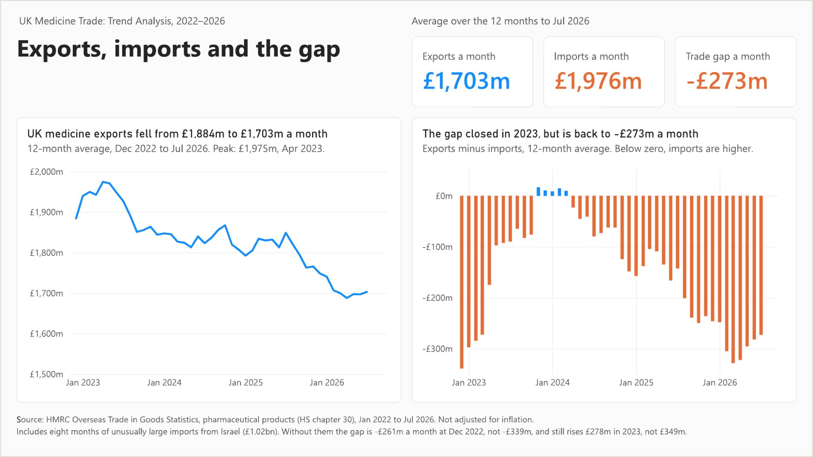

# UK Medicine Trade: Trend Analysis, 2022–2026

Are UK medicine exports growing or shrinking in value, who buys them, and is the UK leaning more on imports?

The scenario: an analyst in a UK government trade department briefs a minister before the Budget on HMRC customs records for medicines (HS chapter 30, pharmaceutical products), January 2022 to July 2026, downloaded on 9 October 2026. The data was checked and cleaned in Python, read on 12-month averages, and shared as a Power BI dashboard, a one-page brief and a slide deck.

## Key result

UK medicine exports are worth less than in 2022. Since a near balance in 2023, the UK has bought more than it sold, by a wider margin each year.

| £bn a year | 2022 | 2023 | 2024 | 2025 | 12 months to Jul 2026 |
| :---- | ----: | ----: | ----: | ----: | ----: |
| Exports | 22.6 | 22.1 | 21.7 | 21.0 | 20.4 |
| Imports | 26.7 | 22.0 | 23.5 | 23.9 | 23.7 |
| Gap (exports minus imports) | -4.1 | +0.1 | -1.8 | -3.0 | -3.3 |

The dashboard, brief and slides show the same figures as an average month (the year's total divided by 12):

| £m a month | 2022 | 2023 | 2024 | 2025 | 12 months to Jul 2026 |
| :---- | ----: | ----: | ----: | ----: | ----: |
| Exports | 1,884 | 1,844 | 1,807 | 1,749 | 1,703 |
| Imports | 2,223 | 1,834 | 1,956 | 1,995 | 1,976 |
| Gap (exports minus imports) | -339 | +10 | -148 | -246 | -273 |

The last column is the 12 months from Aug 2025 to Jul 2026, because 2026 is not a full year yet. The gap is worked out before rounding. The 2022 and 2023 figures include eight months of unusually large imports from Israel (£1.02bn). Without them the 2022 gap is -£261m a month, and 2023 is still a near balance. Customs data shows what moved, not why. Amounts are not adjusted for inflation.

## What stands out

- **Packaged medicines are the biggest group**, at 69.5% of export value over the whole period. Their exports fell every year, from £16.8bn in 2022 to £13.9bn in 2025, the last full year.
- **The latest fall is in value per kg, not weight.** In the 12 months to Jul 2026, export value fell 7.9% on the year before while the weight sold rose 1.8%, so value per kg fell 9.5%. Value per kg also moves with the mix of medicines, so it is not a price.
- **The US, Belgium and Germany took 47% of export value** over the whole period. The US share rose from 22.7% in 2022 to 29.2% in 2023, fell back to 23.3% in 2024, and was 25.0% in 2025 and 26.0% in Jan–Jul 2026 (part year).
- **Four suppliers each sent 12–14% of imports** over the whole period: Belgium, the US, the Netherlands and Germany. These are countries of dispatch, not makers.

The calculations are in the Analyse phase of the [notebook](notebook.ipynb), Steps 1 to 7, and explained in the [documentation](documentation.pdf).

## Deliverables

- [Dashboard (PDF copy)](dashboard.pdf)
- [Dashboard (Power BI file)](dashboard.pbix), opens in Power BI Desktop
- [Executive brief](executive-brief.pdf)
- [Slide deck](presentation.pdf)
- [Full documentation](documentation.pdf)
- [Python notebook](notebook.ipynb)

## Run the notebook

The notebook ran in Google Colab with the data in Google Drive. To rerun it, put the two files from [`data/`](data) in a Drive folder called `Project 3`, with an empty `analysis_tables` folder inside it. HMRC revises recent months, so these files are a snapshot from 9 October 2026 and a new download may differ.

## Tools & Data

Python (pandas) · Power BI · [HMRC Overseas Trade in Goods Statistics](https://www.uktradeinfo.com/trade-data/ots-custom-table/), Jan 2022 – Jul 2026

Contains public sector information licensed under the Open Government Licence v3.0.
